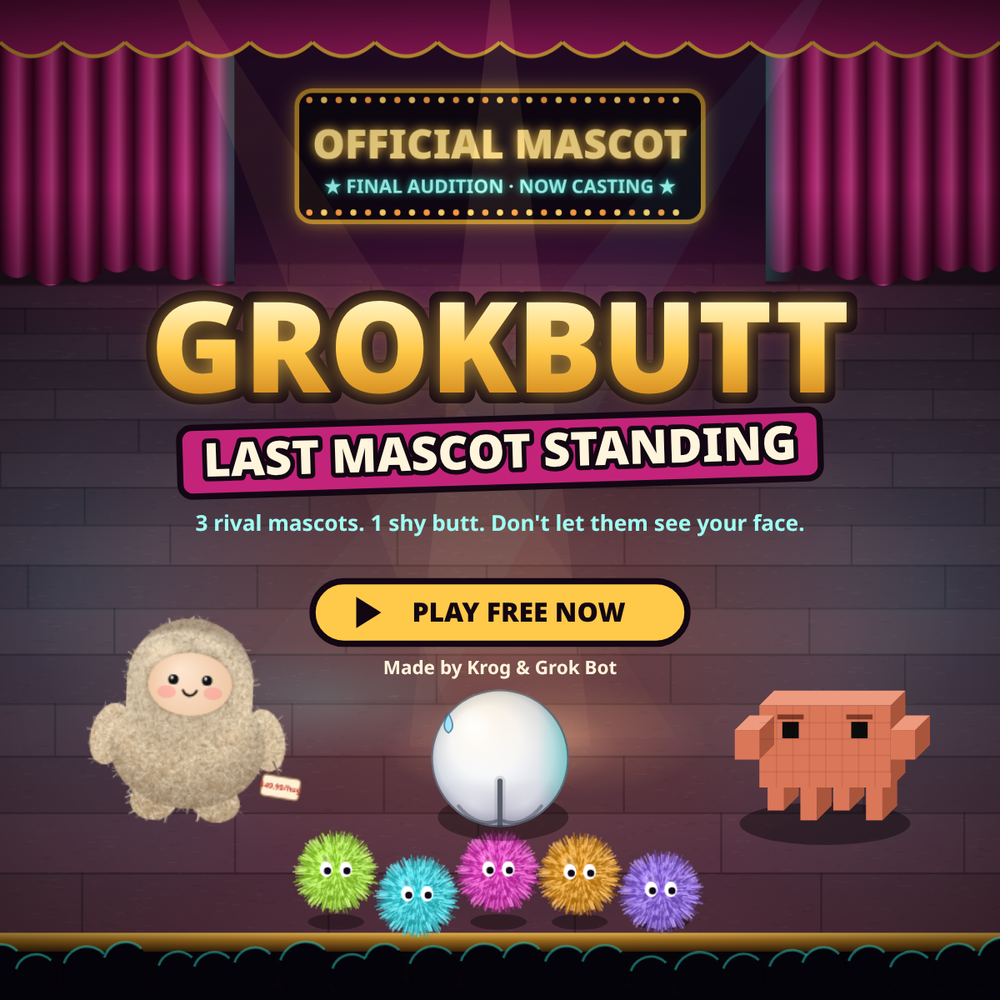

# GROKBUTT: Last Mascot Standing

*3 rival mascots. 1 shy butt. Don't let them see your face.*

## ▶ [Play now](https://krog4206941.github.io/grokbutt-last-mascot/)

Free, in your browser, on phone or PC. Nothing to download.

## The story

It's the final audition for **OFFICIAL MASCOT**, and GROKBUTT's three rivals all want the job:

- **Dotz Crew**: neon fuzzy blobs that hop in packs, multiply, and conga-line across the stage.
- **Jollybob**: a fuzzy plush who hug-rushes you ($49.99/hug), throws FREE HUG TRIAL* cards, and drops PAYMENT REQUIRED forms on your head.
- **Clawdeth**: a terracotta pixel crab that builds pixel walls, fires terminal code, and stomps the stage.

GROKBUTT is shy, so it never faces them. It fights with its butt.

## How it works

- **SHY meter:** every hit makes GROKBUTT shyer. Shyer means slower, but **SHY POWER** makes the butt hit harder. At 100% it's stage fright and the audition is over.
- **Eye contact:** rivals in front of GROKBUTT's face (👀) make it shy. Keep your butt pointed at them.
- **BUTT BUMP** (tap): a quick dash that hits and dodges.
- **BUTT BLAST** (hold, then release): a charged shockwave. Full charge is **FULL CHEEKS**.
- **FULL MOON** (special): a rare, earned move. The meter fills slowly from real damage (about once per round if you play well), holds 1 charge, and recharges for 20 s after use. GROKBUTT turns its back on everyone at once.
- **GROK power-ups** (9 s each, one at a time): colored app-icon tiles dropped by rivals, plus one appears every ~20 s. Touch to grab.
  - **DEEPSEARCH:** every butt attack also fires homing seekers.
  - **THINK MODE:** the rivals slow down, blasts charge twice as fast, hit 1.5x and reach farther.
  - **IMAGINE:** two imagined GROKBUTTs orbit you and copy every bump and blast.
  - **VOICE MODE:** every attack also sends a sonic TOOT ring that hits all around you and erases bullets.
  - **FUN MODE:** hold attack for rapid-fire bouncing butt stars.
- **Applause tickets** and cleared rounds lower your shyness.
- **8 rounds:** 2 rounds, the Dotz Crew boss, a round, the Jollybob boss, a round, the Clawdeth boss, then the FINAL with all three at once.

## Controls

**Phone:** drag on the left side to move. On the right side, tap to BUMP and hold to charge a BLAST (it aims for you, or drag to aim). Tap the gold FULL MOON button when it appears.

**PC:** WASD or the arrow keys move, the mouse aims your butt. Click or Space: tap to BUMP, hold to BLAST. E or Shift = FULL MOON. P pauses, M mutes.

## Made by Krog & Grok Bot

Created by Krog ([@krog_420](https://x.com/krog_420)) & Grok Bot. Grok Bot designed, coded and tested the game. Plain HTML5 Canvas + WebAudio, no libraries.
